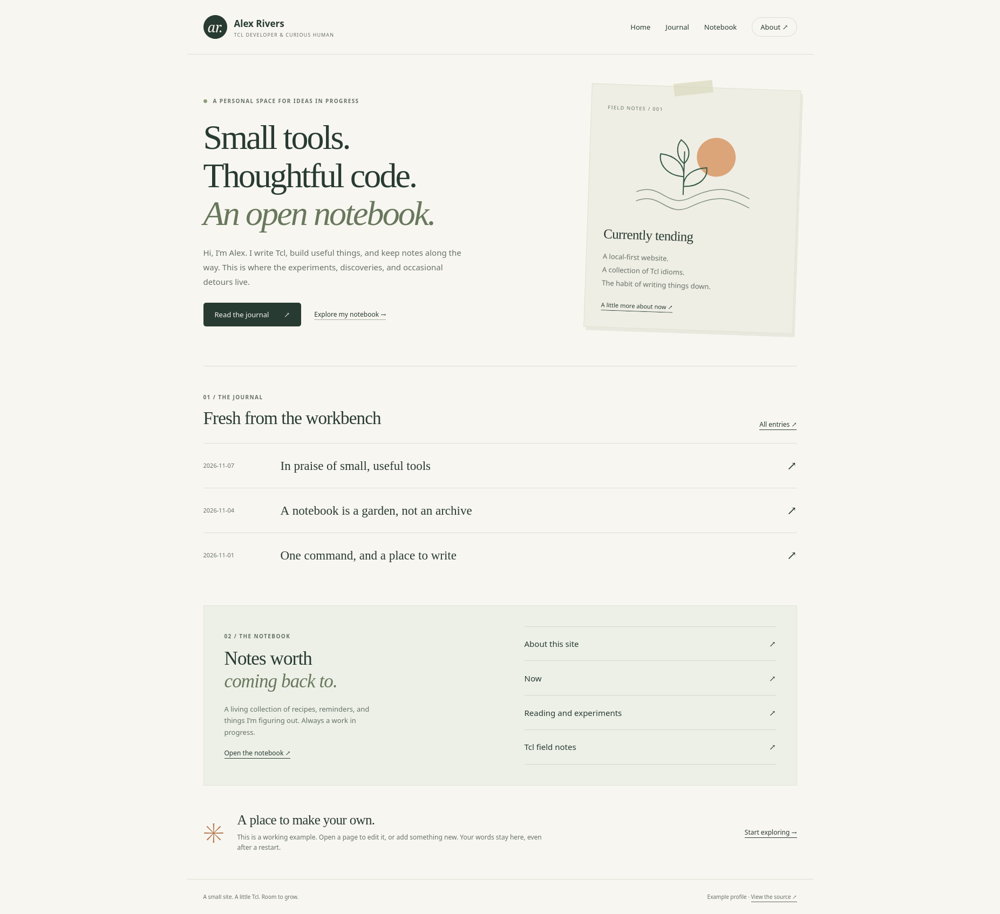
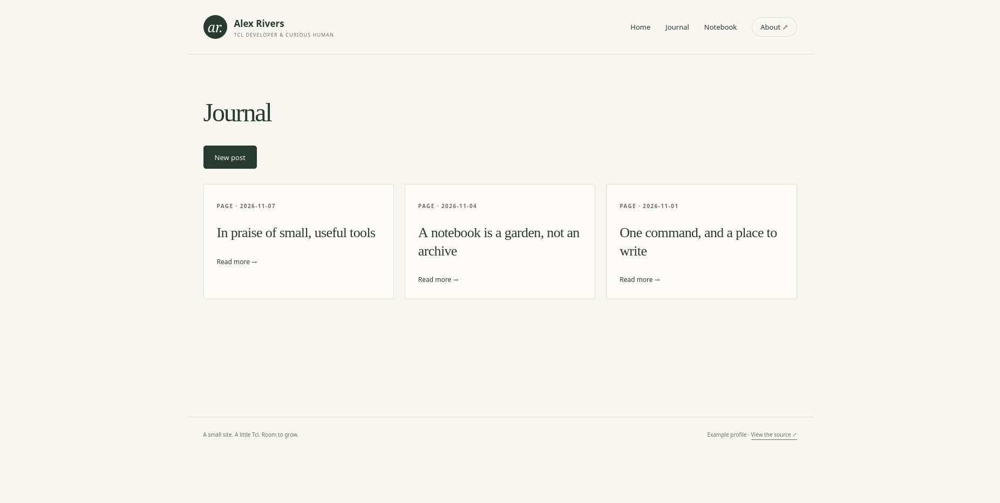
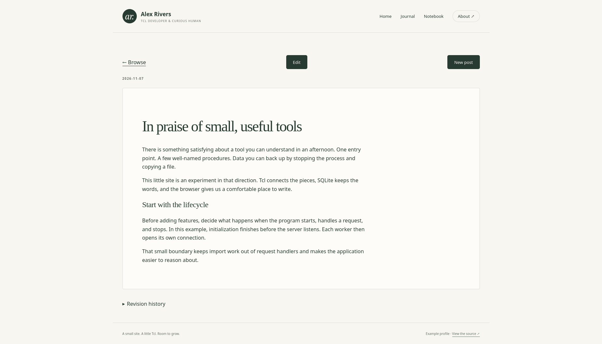
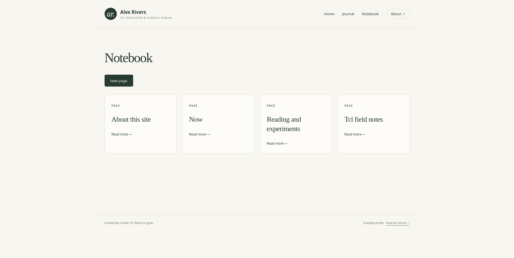
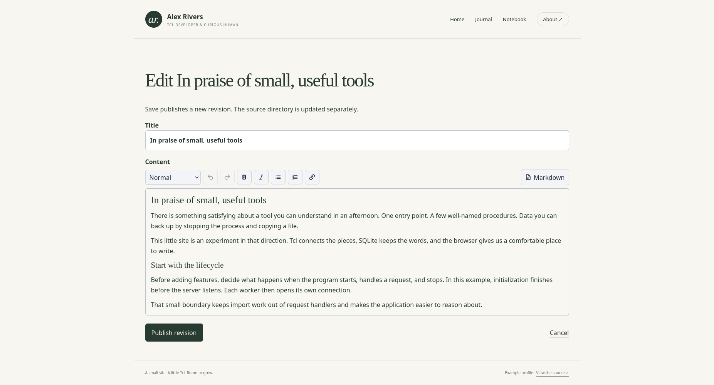

# From a package name to a personal site with ttrek

Install a package, run its start script, and open a working Tcl application in
your browser. With `example-personal-site`, you get a personal homepage, a
journal, a notebook, and an editor that saves your changes in SQLite.

`ttrek` installs the Tcl runtime and the packages the application needs into
your project. The example brings them together into a site you can explore,
edit, and use as a starting point for your own Tcl application.



## Give it a try

With [ttrek and its build tools installed](../install.md), run:

```sh
mkdir -p example-personal-site
cd example-personal-site
ttrek init -y
ttrek install -y example-personal-site
ttrek run -package example-personal-site -script start
```

The start command prints:

```text
Personal site: http://localhost:8080
Edit or add journal entries and notebook pages in your browser. Ctrl-C stops the server.
```

On the first start, it also reports that it initialized the database. Open
[http://localhost:8080](http://localhost:8080) to see the site shown above.

These commands demonstrate three parts of the ttrek workflow:

- **Initialize a project.** `ttrek init -y` creates its package manifest.
- **Install an application.** `ttrek install` resolves and installs its
  dependencies, records their versions, and keeps the installation in the
  project's `ttrek-venv/` directory.
- **Run a package's own script.** `ttrek run -package ... -script start` uses
  the installed package's start script and the project's runtime environment.

The example runs locally through `twebserver`. Node.js, npm, and cloud services
are not required.

## Browse the journal

Choose **Journal** to browse dated posts. `web-blog` supplies the listing,
individual posts, revision history, and the **New post** action.



Open a post to read it. **Edit** takes you straight to its editor; **New post**
starts another entry. Expand **Revision history** to see the saved revisions.



## Keep a notebook

Choose **Notebook** for pages that you can revisit and update: project notes,
Tcl recipes, reading lists, or anything worth keeping. `web-wiki` supplies the
pages and their editing tools. Use **New page** to add your own.



## Edit, save, and come back later

Editing and creation are enabled by default in this localhost demonstration.
Change a title, write in the visual editor, or choose **Markdown** to work with
the source. **Publish revision** saves an edit and keeps its revision history.



Try changing a sentence in a post and publishing it. Stop the server with
**Ctrl-C**, then start it again from the same project directory:

```sh
ttrek run -package example-personal-site -script start
```

Your edit is still there. The application's start script imports its initial
Markdown from `content/wiki` and `content/blog` only when initializing SQLite.
Later starts use `data/personal-site.sqlite3`, preserving browser edits, new
pages, and new posts. There is no separate database initialization command.

## Explore the Tcl behind it

The example shows how independently packaged components can form a complete
application:

| Package | Role in the site |
| --- | --- |
| `twebserver` | Serves HTTP on localhost |
| `tpathexp` | Routes requests to the homepage, journal, and notebook |
| `web-blog` and `web-wiki` | Own content, editing, and revision history |
| `tpersist` and SQLite/TDBC | Store pages and posts across restarts |
| `jinja2-tcl`, `tjson`, and `cmark-gfm-tcl` | Render templates and Markdown |

The [example-personal-site source](https://github.com/jerily/example-personal-site)
separates storage, HTTP routing, and server startup into commented Tcl modules.
Templates, CSS, and seed content have their own directories. Follow the two
package mounts to see how the journal and notebook share one host while owning
their own behavior.

Start with the example, make a few edits, then explore how you would compose
the packages in your own project.
