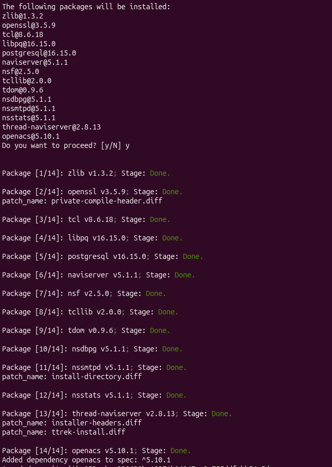
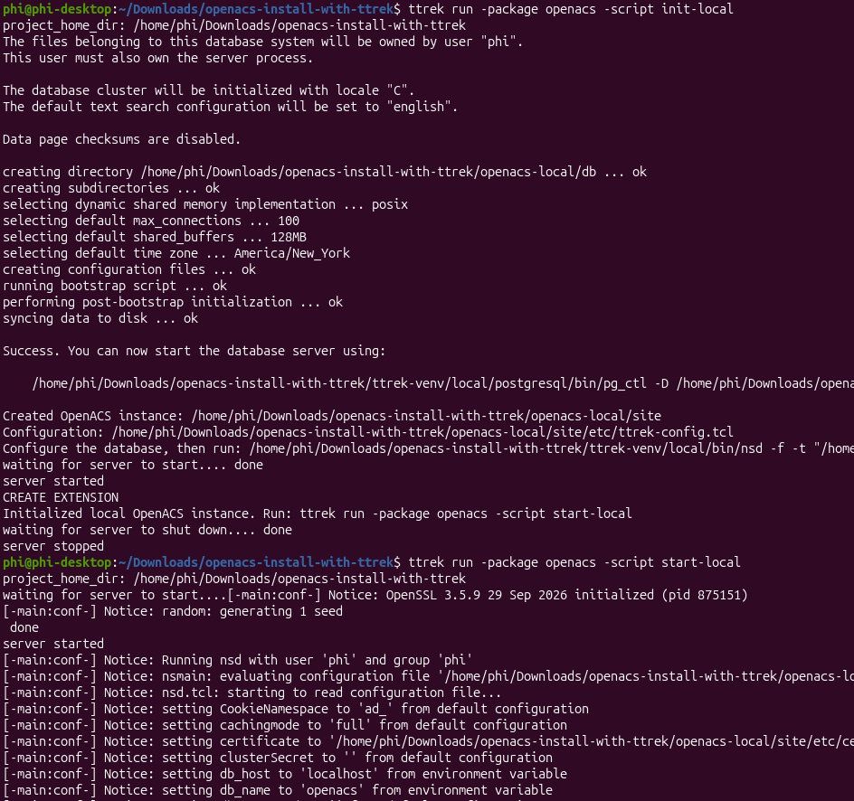

# Install and run OpenACS with ttrek

`ttrek` can now install OpenACS and all its dependencies, including NaviServer,
PostgreSQL, Tcl, and the required modules and libraries. The installed package
also provides scripts to initialize and start a local OpenACS instance.

## Install

With `ttrek` on your `PATH`, create a project and install OpenACS:

```sh
mkdir openacs-project
cd openacs-project
ttrek init -y
ttrek install openacs@5.10.1
```



## Initialize and start

From the same project directory, run these commands as your ordinary user:

```sh
ttrek run -package openacs -script init-local
ttrek run -package openacs -script start-local
```

Run `init-local` once to create the PostgreSQL database and OpenACS instance in
`openacs-local/`. Use `start-local` whenever you want to start the instance; it
runs NaviServer in the foreground and stops PostgreSQL when you exit with Ctrl-C.



Open <http://127.0.0.1:8000/> to complete the web installer and create an
administrator account. When the installer stops NaviServer, run the
`start-local` command again to start the installed application.
