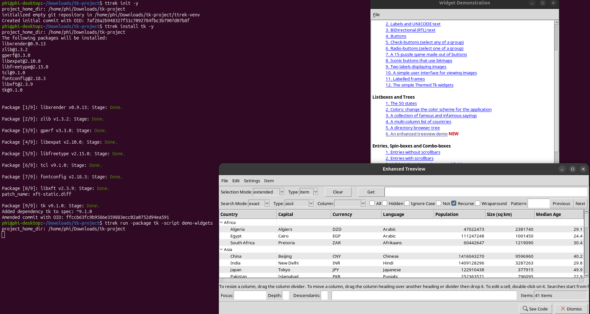

# Install Tk and try its demo widgets with ttrek

`ttrek` can install Tk and its dependencies, including Tcl and the font libraries.
The installed package also provides a script to launch Tk's interactive widget
demonstrations.

## Install

With `ttrek` on your `PATH`, create a project and install Tk:

```sh
mkdir tk-project
cd tk-project
ttrek init -y
ttrek install tk -y
```

## Try the demo widgets

From the same project directory, launch the demo on a graphical desktop with an
available X display:

```sh
ttrek run -package tk -script demo-widgets
```

The **Widget Demonstration** window lists examples of buttons, labels, themed
widgets, listboxes, trees, and more. Click an example to open it and interact with
the widgets. For example, choose **An enhanced treeview demo** under **Listboxes
and Trees** to explore a table of countries, as shown below. Click **See Code** in
the demo window to inspect its Tcl source.



Close the main **Widget Demonstration** window to exit the demo and return to
your terminal.
